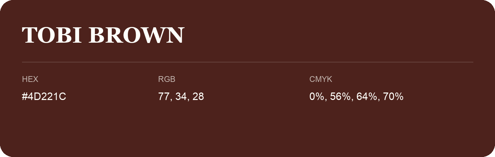

## Tobi Brown

- HEX: #4D221C
- RGB: 77, 34, 28
- CMYK: 0%, 56%, 64%, 70%
- Character: warm, expressive, energetic
- Suggested uses: food brands, expressive identities, promotional accents

- Source images: IMG_9080.JPG
