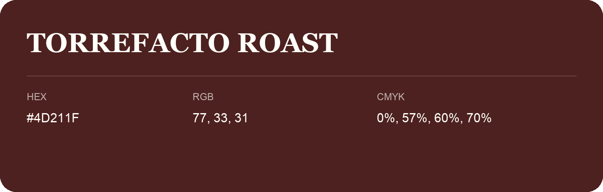

## Torrefacto Roast

- HEX: #4D211F
- RGB: 77, 33, 31
- CMYK: 0%, 57%, 60%, 70%
- Character: warm, expressive, energetic
- Suggested uses: food brands, expressive identities, promotional accents

- Source images: IMG_9063.JPG
