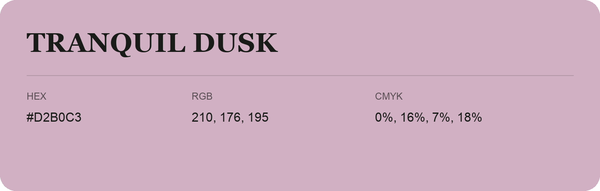

## Tranquil Dusk

- HEX: #D2B0C3
- RGB: 210, 176, 195
- CMYK: 0%, 16%, 7%, 18%
- Character: soft, gentle, approachable
- Suggested uses: friendly consumer brands, gentle backgrounds, welcoming accents

- Source images: IMG_9037.JPG

- Data provenance: HEX recovered from page data; cross-checked against the readable source RGB.
