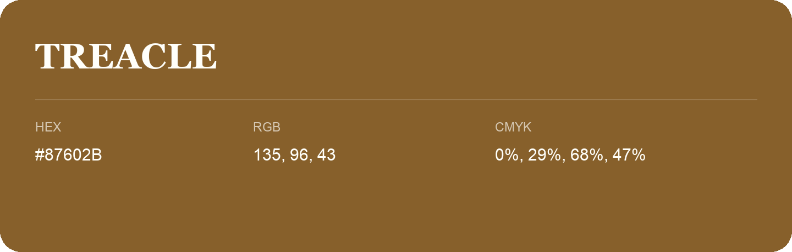

## Treacle

- HEX: #87602B
- RGB: 135, 96, 43
- CMYK: 0%, 29%, 68%, 47%
- Character: earthy, rich, warm
- Suggested uses: premium packaging, rustic brands, dark backgrounds

- Source images: iCloud Photos 2/IMG_9130.JPG
