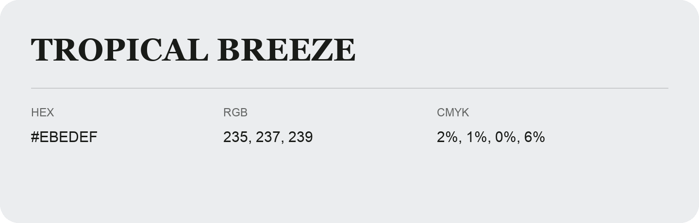

## Tropical Breeze

- HEX: #EBEDEF
- RGB: 235, 237, 239
- CMYK: 2%, 1%, 0%, 6%
- Character: quiet, balanced, understated
- Suggested uses: professional services, minimal identities, supporting backgrounds

- Source images: IMG_9007.JPG

- Data provenance: HEX recovered from page data; cross-checked against the readable source RGB.
