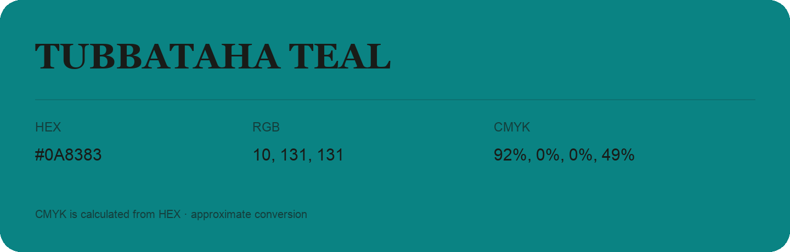

## Tubbataha Teal

- HEX: #0A8383
- RGB: 10, 131, 131
- CMYK: 92%, 0%, 0%, 49%
- Character: calm, fresh, composed
- Suggested uses: wellness brands, coastal hospitality, modern service brands

- Source images: IMG_8978.JPG

- Data provenance: HEX recovered from page data; cross-checked against the readable source RGB.
- Data provenance: CMYK calculated from HEX using the page’s conversion; source image CMYK was unreadable. This is an approximate conversion without a print color profile.
