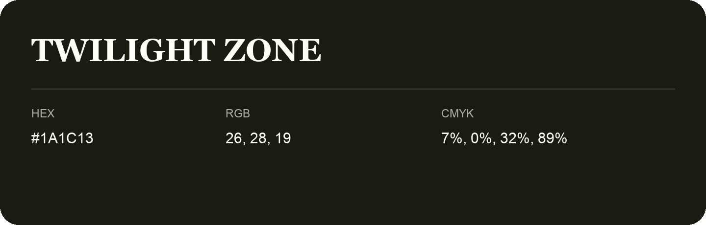

## Twilight Zone

- HEX: #1A1C13
- RGB: 26, 28, 19
- CMYK: 7%, 0%, 32%, 89%
- Character: deep, grounded, understated
- Suggested uses: premium packaging, editorial typography, dark backgrounds

- Source images: iCloud Photos 2/IMG_9182.JPG
