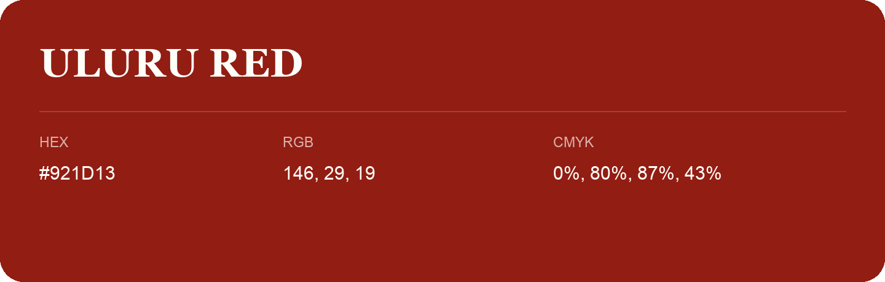

## Uluru Red

- HEX: #921D13
- RGB: 146, 29, 19
- CMYK: 0%, 80%, 87%, 43%
- Character: warm, expressive, energetic
- Suggested uses: food brands, expressive identities, promotional accents

- Source images: IMG_9055.JPG
