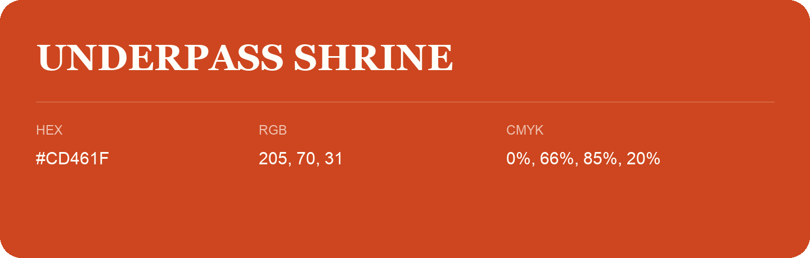

## Underpass Shrine

- HEX: #CD461F
- RGB: 205, 70, 31
- CMYK: 0%, 66%, 85%, 20%
- Character: warm, expressive, energetic
- Suggested uses: food brands, expressive identities, promotional accents

- Source images: iCloud Photos 2/IMG_9184.JPG
