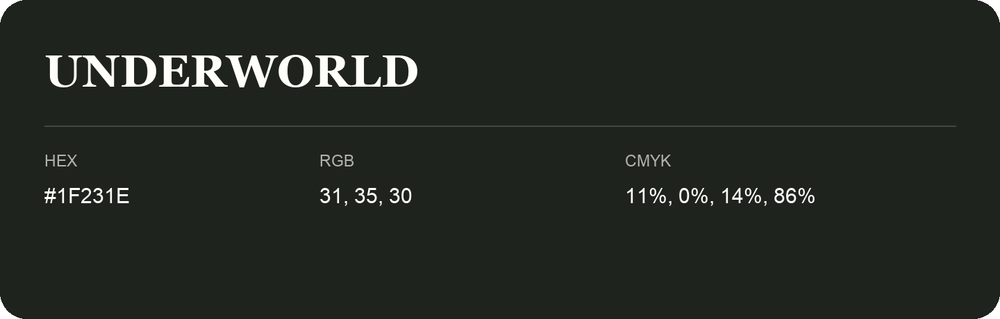

## Underworld

- HEX: #1F231E
- RGB: 31, 35, 30
- CMYK: 11%, 0%, 14%, 86%
- Character: deep, grounded, understated
- Suggested uses: premium packaging, editorial typography, dark backgrounds

- Source images: iCloud Photos 2/IMG_9179.JPG

- Name note: Other distinct shades share this name: [underworld](underworld.md).
