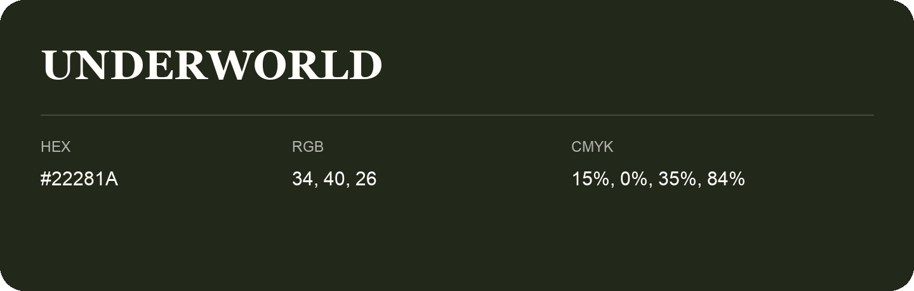

## Underworld

- HEX: #22281A
- RGB: 34, 40, 26
- CMYK: 15%, 0%, 35%, 84%
- Character: natural, grounded, fresh
- Suggested uses: outdoor businesses, wellness brands, organic packaging

- Source images: IMG_9111.JPG

- Name note: Other distinct shades share this name: [underworld-1f231e](underworld-1f231e.md).
