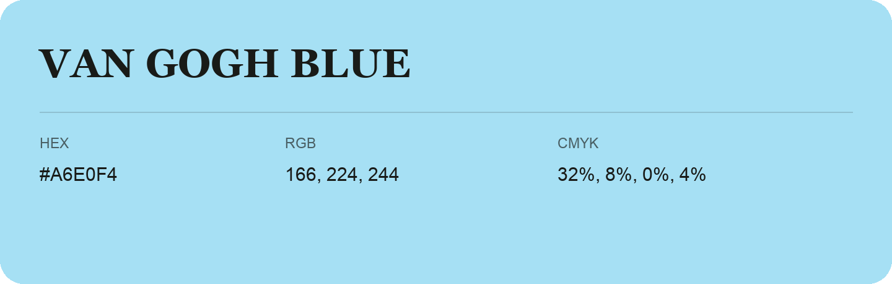

## Van Gogh Blue

- HEX: #A6E0F4
- RGB: 166, 224, 244
- CMYK: 32%, 8%, 0%, 4%
- Character: soft, gentle, approachable
- Suggested uses: friendly consumer brands, gentle backgrounds, welcoming accents

- Source images: IMG_9002.JPG

- Data provenance: HEX recovered from page data; cross-checked against the recognized source text with visually equivalent glyphs.
- Data provenance: RGB calculated from HEX, matching the page; source image RGB was unreadable.
