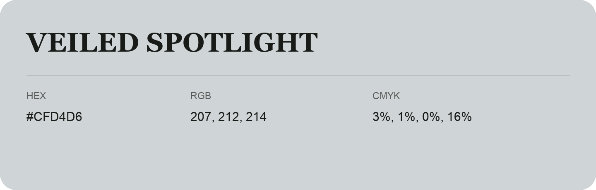

## Veiled Spotlight

- HEX: #CFD4D6
- RGB: 207, 212, 214
- CMYK: 3%, 1%, 0%, 16%
- Character: quiet, balanced, understated
- Suggested uses: professional services, minimal identities, supporting backgrounds

- Source images: IMG_9028.JPG
