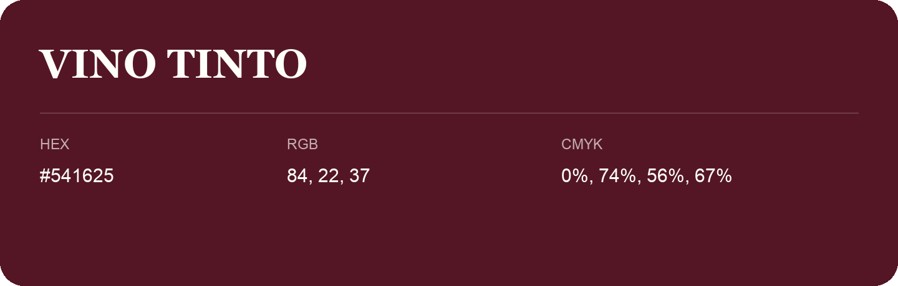

## Vino Tinto

- HEX: #541625
- RGB: 84, 22, 37
- CMYK: 0%, 74%, 56%, 67%
- Character: deep, grounded, understated
- Suggested uses: premium packaging, editorial typography, dark backgrounds

- Source images: iCloud Photos 2/IMG_9131.JPG
