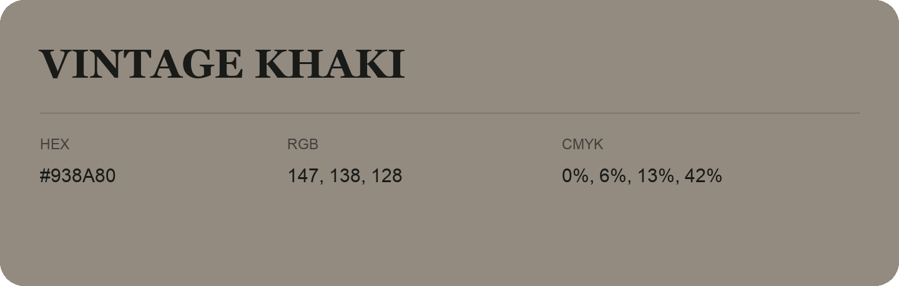

## Vintage Khaki

- HEX: #938A80
- RGB: 147, 138, 128
- CMYK: 0%, 6%, 13%, 42%
- Character: quiet, balanced, understated
- Suggested uses: professional services, minimal identities, supporting backgrounds

- Source images: iCloud Photos 2/IMG_9142.JPG
- Data provenance: RGB calculated from HEX; source text recognition was uncertain.
