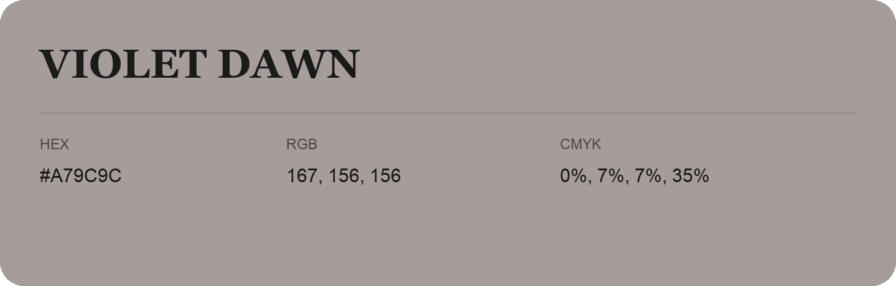

## Violet Dawn

- HEX: #A79C9C
- RGB: 167, 156, 156
- CMYK: 0%, 7%, 7%, 35%
- Character: quiet, balanced, understated
- Suggested uses: professional services, minimal identities, supporting backgrounds

- Source images: IMG_9073.JPG
