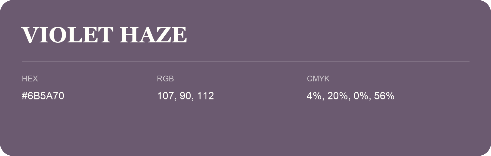

## Violet Haze

- HEX: #6B5A70
- RGB: 107, 90, 112
- CMYK: 4%, 20%, 0%, 56%
- Character: expressive, imaginative, refined
- Suggested uses: beauty brands, creative businesses, distinctive accents

- Source images: iCloud Photos 2/IMG_9137.JPG
