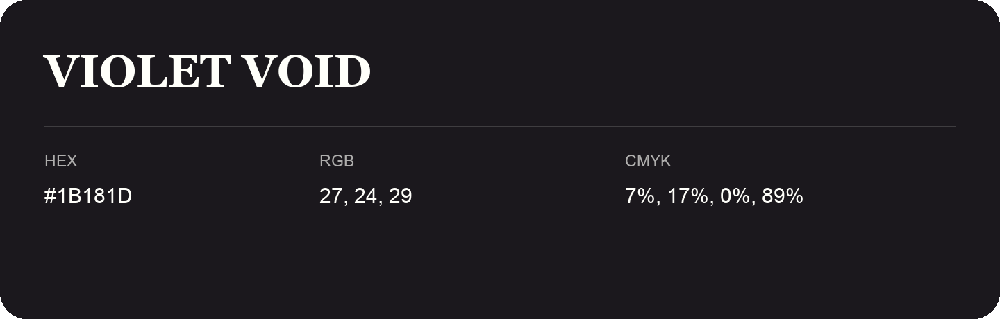

## Violet Void

- HEX: #1B181D
- RGB: 27, 24, 29
- CMYK: 7%, 17%, 0%, 89%
- Character: expressive, imaginative, refined
- Suggested uses: beauty brands, creative businesses, distinctive accents

- Source images: IMG_9068.JPG
