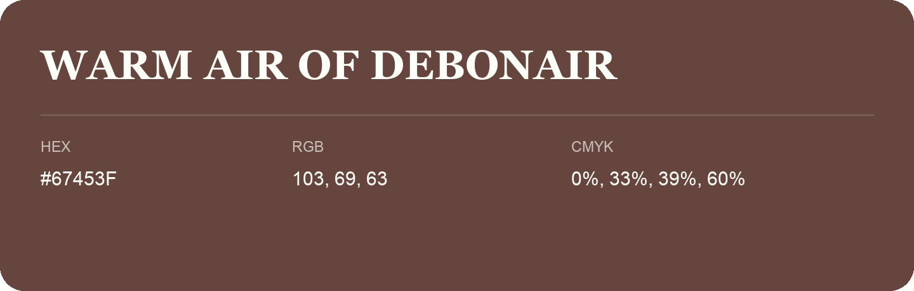

## Warm Air Of Debonair

- HEX: #67453F
- RGB: 103, 69, 63
- CMYK: 0%, 33%, 39%, 60%
- Character: warm, expressive, energetic
- Suggested uses: food brands, expressive identities, promotional accents

- Source images: iCloud Photos 2/IMG_9174.JPG
