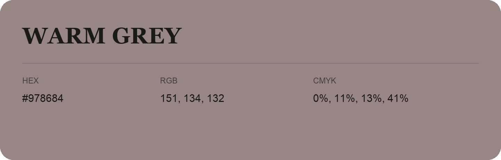

## Warm Grey

- HEX: #978684
- RGB: 151, 134, 132
- CMYK: 0%, 11%, 13%, 41%
- Character: quiet, balanced, understated
- Suggested uses: professional services, minimal identities, supporting backgrounds

- Source images: IMG_9056.JPG
