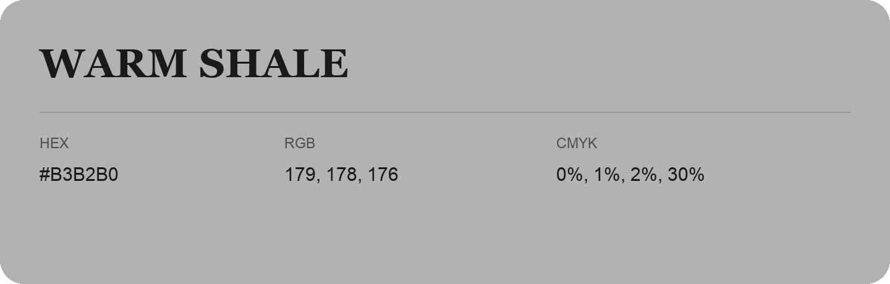

## Warm Shale

- HEX: #B3B2B0
- RGB: 179, 178, 176
- CMYK: 0%, 1%, 2%, 30%
- Character: quiet, balanced, understated
- Suggested uses: professional services, minimal identities, supporting backgrounds

- Source images: iCloud Photos 2/IMG_9170.JPG
- Data provenance: RGB calculated from HEX; source text recognition was uncertain.
