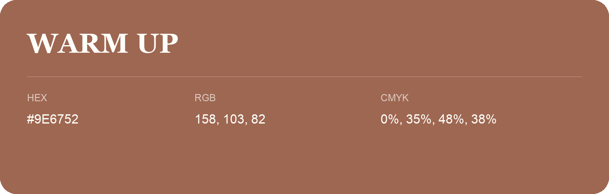

## Warm Up

- HEX: #9E6752
- RGB: 158, 103, 82
- CMYK: 0%, 35%, 48%, 38%
- Character: earthy, rich, warm
- Suggested uses: artisan businesses, hospitality brands, warm accents

- Source images: iCloud Photos 2/IMG_9146.JPG
- Data provenance: RGB calculated from HEX; source text recognition was uncertain.
