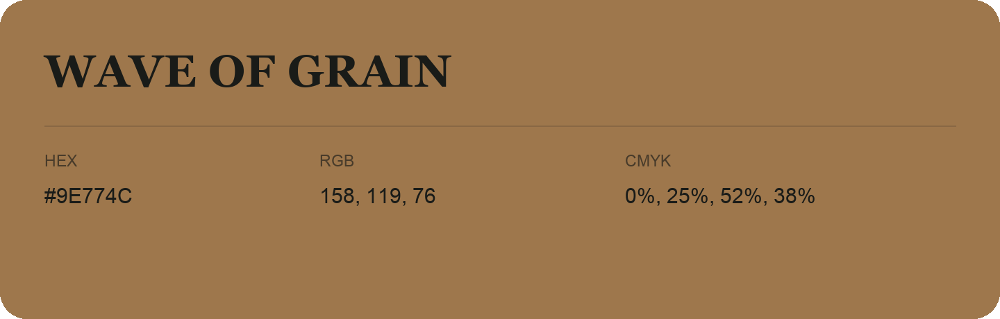

## Wave Of Grain

- HEX: #9E774C
- RGB: 158, 119, 76
- CMYK: 0%, 25%, 52%, 38%
- Character: earthy, rich, warm
- Suggested uses: artisan businesses, hospitality brands, warm accents

- Source images: IMG_9099.JPG
