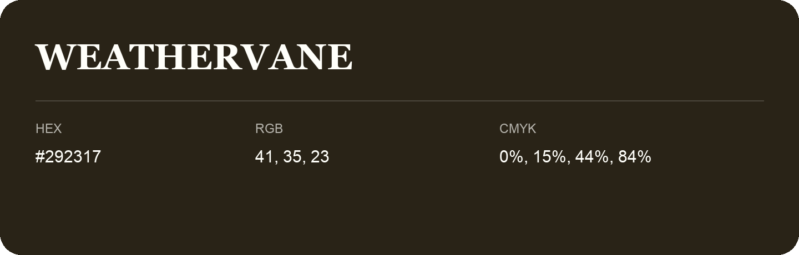

## Weathervane

- HEX: #292317
- RGB: 41, 35, 23
- CMYK: 0%, 15%, 44%, 84%
- Character: deep, grounded, understated
- Suggested uses: premium packaging, editorial typography, dark backgrounds

- Source images: IMG_9020.JPG

- Name note: Other distinct shades share this name: [weathervane-2a261a](weathervane-2a261a.md).
