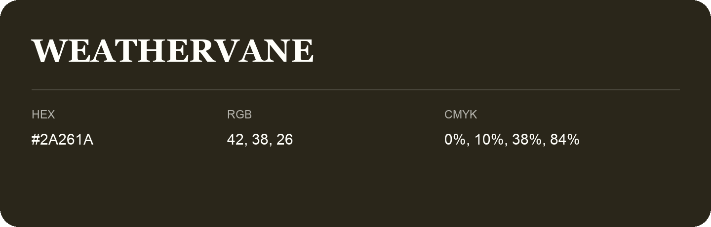

## Weathervane

- HEX: #2A261A
- RGB: 42, 38, 26
- CMYK: 0%, 10%, 38%, 84%
- Character: deep, grounded, understated
- Suggested uses: premium packaging, editorial typography, dark backgrounds

- Source images: IMG_9064.JPG

- Name note: Other distinct shades share this name: [weathervane-292317](weathervane-292317.md).
