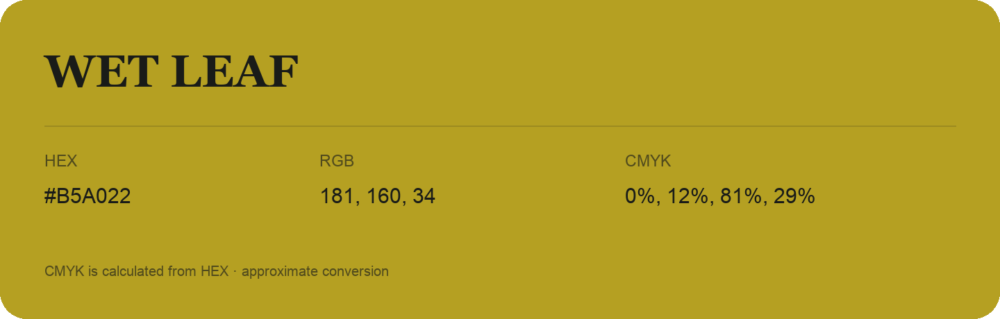

## Wet Leaf

- HEX: #B5A022
- RGB: 181, 160, 34
- CMYK: 0%, 12%, 81%, 29%
- Character: sunny, lively, optimistic
- Suggested uses: friendly consumer brands, food packaging, cheerful accents

- Source images: iCloud Photos 2/IMG_9170.JPG
- Data provenance: CMYK calculated from HEX; source text recognition was uncertain. Approximate conversion without a print color profile.
