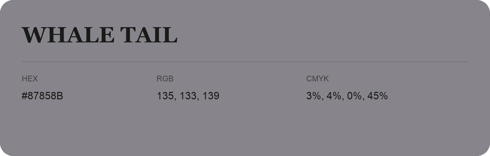

## Whale Tail

- HEX: #87858B
- RGB: 135, 133, 139
- CMYK: 3%, 4%, 0%, 45%
- Character: quiet, balanced, understated
- Suggested uses: professional services, minimal identities, supporting backgrounds

- Source images: IMG_9097.JPG
