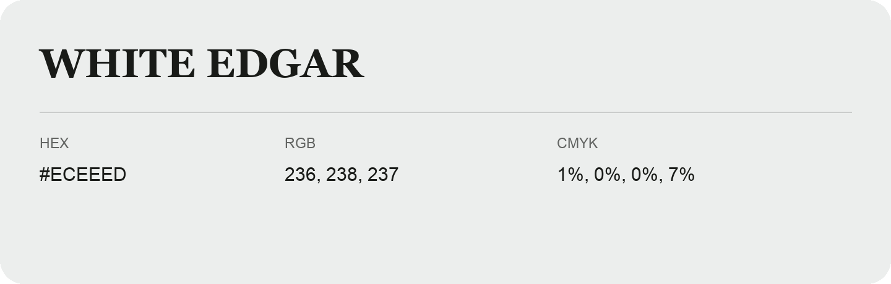

## White Edgar

- HEX: #ECEEED
- RGB: 236, 238, 237
- CMYK: 1%, 0%, 0%, 7%
- Character: quiet, balanced, understated
- Suggested uses: professional services, minimal identities, supporting backgrounds

- Source images: IMG_9089.JPG

- Data provenance: HEX and RGB visually verified against IMG_9089.JPG.
