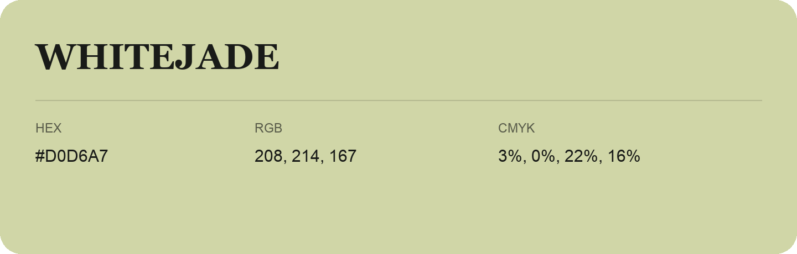

## Whitejade

- HEX: #D0D6A7
- RGB: 208, 214, 167
- CMYK: 3%, 0%, 22%, 16%
- Character: soft, gentle, approachable
- Suggested uses: friendly consumer brands, gentle backgrounds, welcoming accents

- Source images: IMG_9083.JPG

- Data provenance: HEX recovered from page data; cross-checked against the readable source RGB.
