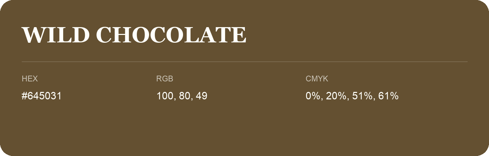

## Wild Chocolate

- HEX: #645031
- RGB: 100, 80, 49
- CMYK: 0%, 20%, 51%, 61%
- Character: earthy, rich, warm
- Suggested uses: premium packaging, rustic brands, dark backgrounds

- Source images: IMG_9020.JPG
