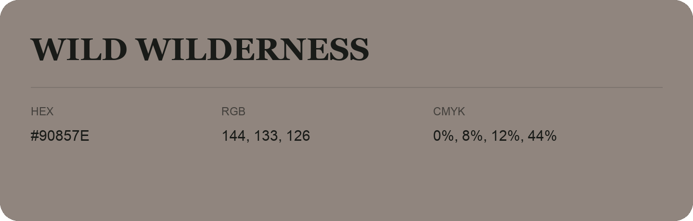

## Wild Wilderness

- HEX: #90857E
- RGB: 144, 133, 126
- CMYK: 0%, 8%, 12%, 44%
- Character: quiet, balanced, understated
- Suggested uses: professional services, minimal identities, supporting backgrounds

- Source images: IMG_9091.JPG
