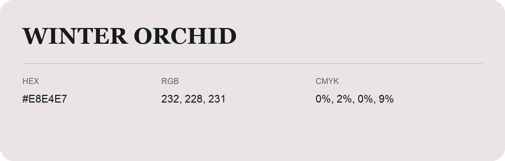

## Winter Orchid

- HEX: #E8E4E7
- RGB: 232, 228, 231
- CMYK: 0%, 2%, 0%, 9%
- Character: quiet, balanced, understated
- Suggested uses: professional services, minimal identities, supporting backgrounds

- Source images: IMG_9061.JPG
