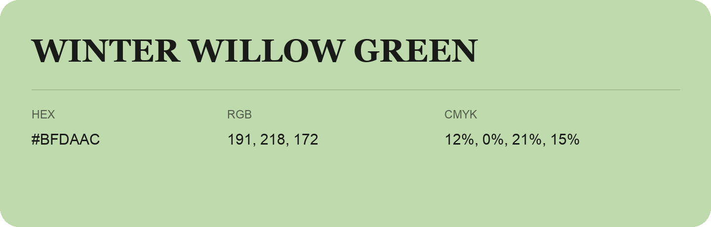

## Winter Willow Green

- HEX: #BFDAAC
- RGB: 191, 218, 172
- CMYK: 12%, 0%, 21%, 15%
- Character: soft, gentle, approachable
- Suggested uses: friendly consumer brands, gentle backgrounds, welcoming accents

- Source images: IMG_9092.JPG

- Data provenance: HEX recovered from page data; cross-checked against the readable source RGB.
