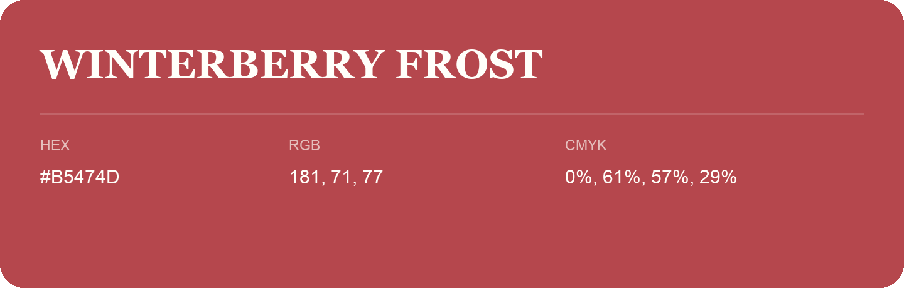

## Winterberry Frost

- HEX: #B5474D
- RGB: 181, 71, 77
- CMYK: 0%, 61%, 57%, 29%
- Character: warm, expressive, energetic
- Suggested uses: food brands, expressive identities, promotional accents

- Source images: iCloud Photos 2/IMG_9174.JPG
