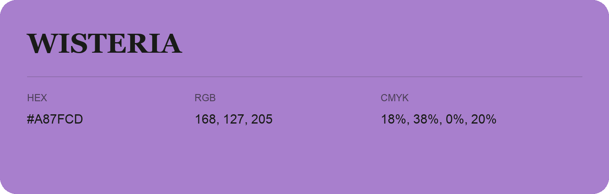

## Wisteria

- HEX: #A87FCD
- RGB: 168, 127, 205
- CMYK: 18%, 38%, 0%, 20%
- Character: soft, gentle, approachable
- Suggested uses: friendly consumer brands, gentle backgrounds, welcoming accents

- Source images: iCloud Photos 2/IMG_9182.JPG
