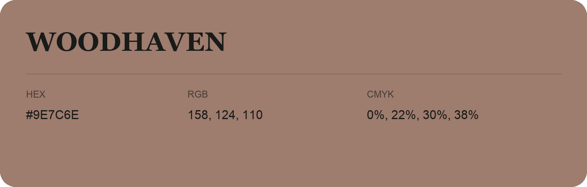

## Woodhaven

- HEX: #9E7C6E
- RGB: 158, 124, 110
- CMYK: 0%, 22%, 30%, 38%
- Character: earthy, rich, warm
- Suggested uses: artisan businesses, hospitality brands, warm accents

- Source images: IMG_9057.JPG
