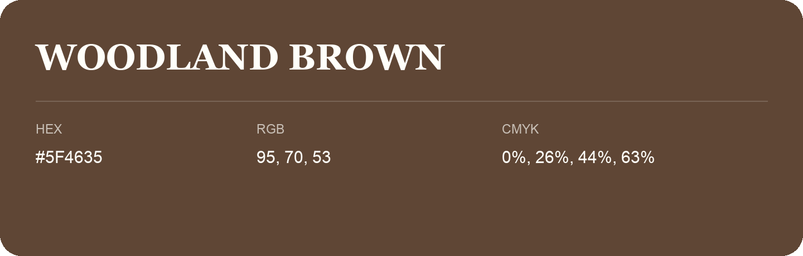

## Woodland Brown

- HEX: #5F4635
- RGB: 95, 70, 53
- CMYK: 0%, 26%, 44%, 63%
- Character: earthy, rich, warm
- Suggested uses: premium packaging, rustic brands, dark backgrounds

- Source images: IMG_9099.JPG
