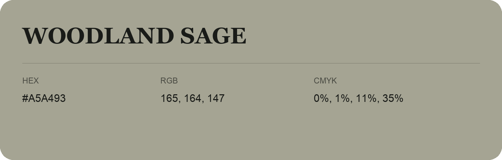

## Woodland Sage

- HEX: #A5A493
- RGB: 165, 164, 147
- CMYK: 0%, 1%, 11%, 35%
- Character: quiet, balanced, understated
- Suggested uses: professional services, minimal identities, supporting backgrounds

- Source images: iCloud Photos 2/IMG_9165.JPG
