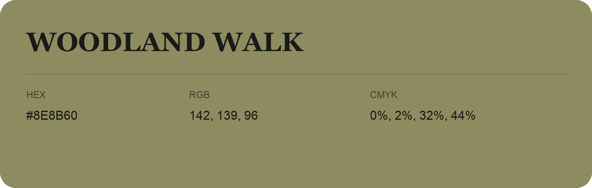

## Woodland Walk

- HEX: #8E8B60
- RGB: 142, 139, 96
- CMYK: 0%, 2%, 32%, 44%
- Character: sunny, lively, optimistic
- Suggested uses: friendly consumer brands, food packaging, cheerful accents

- Source images: IMG_9071.JPG
