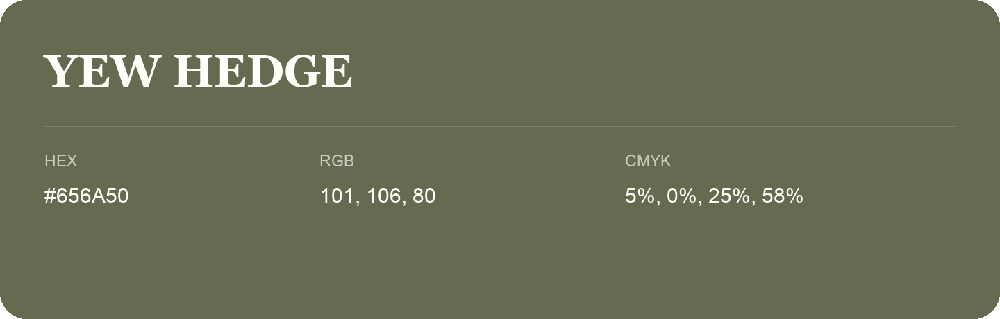

## Yew Hedge

- HEX: #656A50
- RGB: 101, 106, 80
- CMYK: 5%, 0%, 25%, 58%
- Character: natural, grounded, fresh
- Suggested uses: outdoor businesses, wellness brands, organic packaging

- Source images: IMG_9063.JPG
