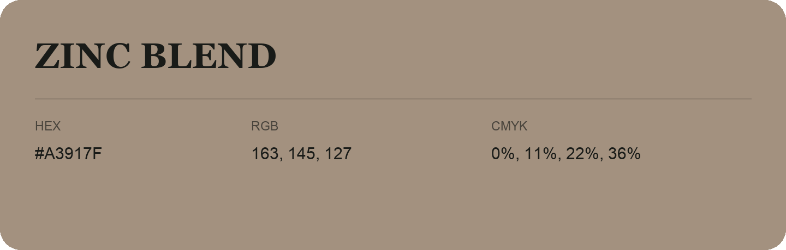

## Zinc Blend

- HEX: #A3917F
- RGB: 163, 145, 127
- CMYK: 0%, 11%, 22%, 36%
- Character: earthy, rich, warm
- Suggested uses: artisan businesses, hospitality brands, warm accents

- Source images: IMG_9058.JPG
- Verification flag: Color name requires visual verification; text recognition was uncertain.
